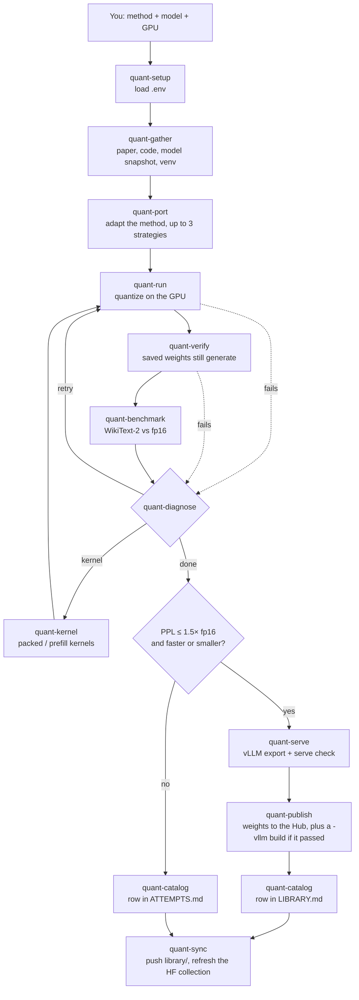

# QuantPort

Skills that let your AI agent (Claude Code, Cursor, Codex, …) port a
quantization **method** onto a **model** on a **GPU**, then measure it
against the original fp16 checkpoint on WikiText-2 (perplexity, tok/s, VRAM).

```text
port SmoothQuant to ibm-granite/granite-3.3-2b-instruct on g5.2xlarge
```

Open this repo in your agent on the GPU host and invoke `quant`. It finds the
paper and code, runs one job, checks that the saved weights still generate,
and publishes successful runs. When the format allows, it also publishes a
vLLM build of the same weights.

Note: Ports could utilize already existing quantization formats in literature or adapt to unsupported models.



## Library

A run is published when perplexity stays within 1.5× fp16 **and** VRAM or
speed beats fp16.

- [LIBRARY.md](library/LIBRARY.md): ranked runs, with vLLM results
- [ATTEMPTS.md](library/ATTEMPTS.md): unsuccessful runs
- [Hugging Face collection](https://huggingface.co/collections/chris320211/quant-agent-library-6aaf22fcafd69b39eabc9230): the weights

## Setup

Use a disposable NVIDIA GPU host (CUDA 12.x, Python ≥ 3.10). The agent runs
third-party method code there.

```bash
git clone https://github.com/chris320211/QuantPort.git
cd QuantPort
python -m pip install -c constraints.txt -e '.[dev]'
cp .env.example .env && chmod 600 .env   # then set HF_TOKEN in your editor
source agents/skills/_shared/load_env.sh .env
```

Run the `source` line in each new terminal. `.env` is gitignored; never paste
the token into chat.

## Outputs

| Path | What |
| --- | --- |
| `quantized/<slug>` | Quantized weights |
| `quantized/<slug>-vllm` | The same weights in vLLM's format |
| `jobs/<id>/benchmark.json` | WikiText-2 vs fp16 |
| `jobs/<id>/vllm.json` | vLLM vs vLLM fp16 on the same GPU |

## Docs

- [agents/README.md](agents/README.md): skills and workflow
- [agents/AGENTS.md](agents/AGENTS.md): how the agent starts; secret rules
- [agents/skills/](agents/skills/): one `SKILL.md` per stage
